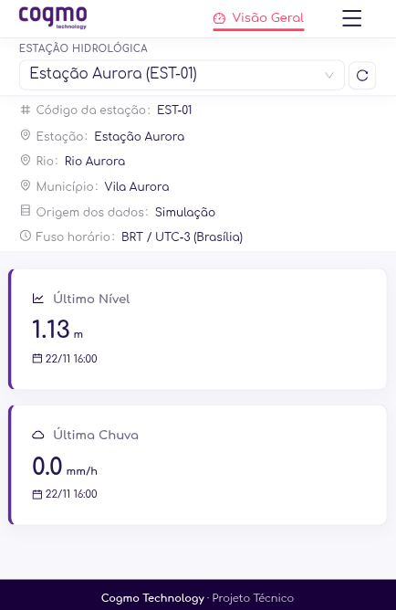
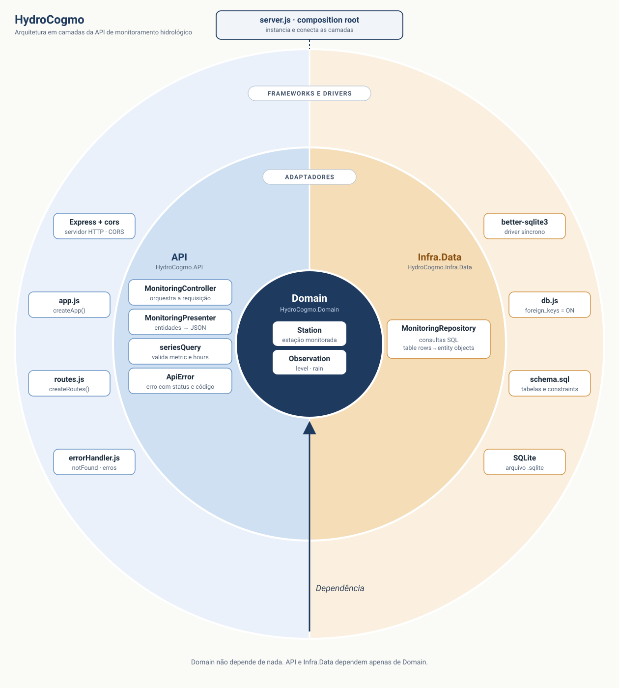
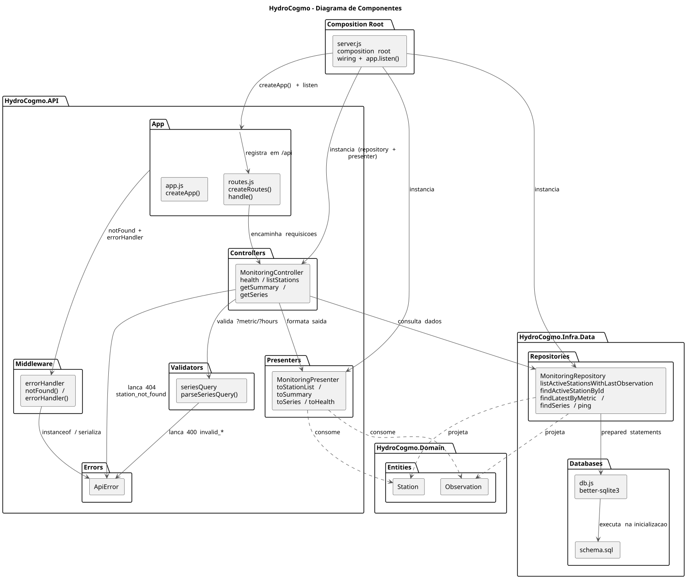

# Monitoramento Hidrológico

API REST com dados hidrológicos de nível de rio e precipitação pluvial simulados.  

||  
|---|  

<br />Acesse o aplicativo: https://hydrocogmo.vercel.app/  

## Links  

#### API REST com dados simulados:  

https://monitoramento-hidrologico-api.onrender.com

| Nome | Método | Endpoint  
| :---: | :---: | :--- | 
| Health | GET | api/health |
| Stations | GET | api/stations |
| Summary | GET | api/stations/{stationid}/summary |
| Series | GET | api/stations/{stationid}/series?metric={metric}&hours={timeframe} |

#### Repositório front end:  
https://github.com/silver-ward/monitoramento-hidrologico  

#### Repositório back end:  
https://github.com/silver-ward/monitoramento-hidrologico-API

## Desenvolvimento

### Tecnologias e bibliotecas utilizadas:  
* **JavaScript**  
    Linguagem de programação e estruturação.  
* **Node.js**  
    Ambiente de execução para JavaScript.  
* **Express**  
    Framework web para Node.js com definição de rotas e tratamento de requisições de API.  
* **SQLite**  
    Sistema de gerenciamento de banco de dados relacional.

## Modelagem dos Dados

### Diagrama de Classes

Para visualizar o diagrama completo, renderize o conteúdo de /diagrams/full_diagram.puml no endereço https://www.plantuml.com/plantuml.  

**Diagrama de arquitetura**  
||  
|---|  


**Diagrama de componentes**  
||  
|---|  


## Execução Local

Para executar este projeto localmente, siga os seguintes passos em um terminal de comandos:  
   
* Integração com este repositório no GitHub  
    Pré-requisitos: [Git](https://git-scm.com/).  


    1. **Clone o repositório:**
        ```
        git clone https://github.com/silver-ward/monitoramento-hidrologico.git
        ```

    2. **Entre no diretório que foi clonado:**
        ```
        cd monitoramento-hidrologico
        ```

* Execução do código  
    Pré-requisitos: [Node.js](https://nodejs.org/).  

    3. **Instale as dependências:**
        ```
        npm install
        ```

    4. **Inicie o servidor de desenvolvimento:**
        ```
        npm run dev
        ```

    5. **Abra no navegador o endereço localhost especificado no terminal.**  
        Exemplo:  
        ```
        http://localhost:5173/
        ```

    Para acessar dados de uma API, defina URLs sem proteção CORS no arquivo /src/data/DAOs/configURL.js.  

## Licença

Projeto desenvolvido por Eduardo Ribeiro para a Cogmo Technology no âmbito do programa Bolsa Futuro Digital, realizado por parceria entre o Instituto Hardware Brasil e o Instituto Federal de Brasília.

